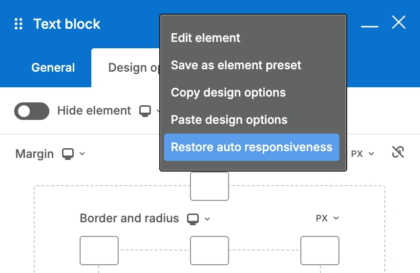

import Head from '@docusaurus/Head';

<Head>
  <title>Restore automatic responsiveness | WPBakery</title>
  <meta property="og:title" content="Restore automatic responsiveness | WPBakery" />
</Head>

# Can I restore automatic responsiveness for an element in WPBakery?

Yes, you can use **Restore auto responsiveness** to remove an element’s device-specific customizations.

1. Open the element edit window.
2. Open the menu at the top of the window.
3. Select **Restore auto responsiveness**.

This clears the selected element’s responsive overrides and returns all device views to its desktop values.

For more information about device-specific settings, see [Responsive settings](../building-with-wpbakery/responsive-settings.md).

Available since 9.2

